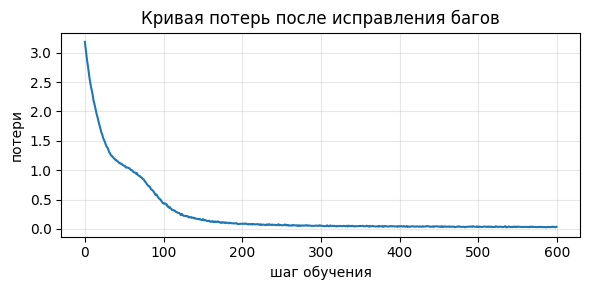
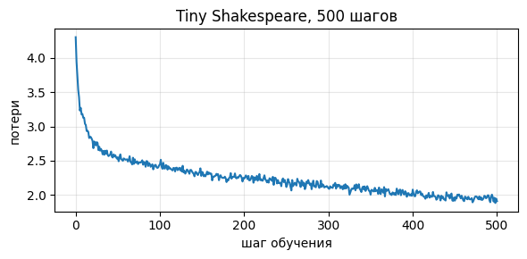

# ДЗ1

- `dz1_attention.ipynb` - 4 функции, тесты 17/17
- `dz1_bughunt.ipynb` - вариант seed 42, 3 бага, тесты 17/17
- `results/` - графики и генерация
- `original/` - исходные ноутбуки

## Запуск

Colab, T4, Run all

Локально:

```
python3.11 -m venv .venv
.venv/bin/pip install -r requirements.txt
.venv/bin/jupyter nbconvert --to notebook --execute --inplace dz1_attention.ipynb
.venv/bin/jupyter nbconvert --to notebook --execute --inplace dz1_bughunt.ipynb
```

seed 42, обучение в bughunt использует свой `torch.manual_seed(0)` из исходного ноутбука

Запускал в Colab на Tesla T4: python 3.13.16, torch 2.14.1+cu130, numpy 2.4.6

## Баги

| # | где | что ломается | фикс |
|---|---|---|---|
| 1 | `sinusoidal_positional_encoding`, `arange(1, length+1)` | позиции считаются с 1, все коды сдвинуты на одну позицию, у первого токена sin(w)/cos(w) вместо 0/1 | `arange(length)` |
| 2 | `LayerNorm.forward`, `dim=0` | среднее и дисперсия считаются по батчу, поэтому пример зависит от соседей по батчу, а при батче 1 на выходе только bias | `dim=-1` |
| 3 | `scaled_dot_product_attention`, `softmax(dim=-2)` | softmax идёт по оси запросов, строки весов не суммируются в 1, и в веса раннего токена протекают будущие токены | `dim=-1` |

## Обучение

Ячейка из ноутбука: лосс 3.18 -> 0.04, генерирует "алгоритм внимания смотрит на все позиции сразу"



Плюс tiny-shakespeare с конфигом из задания (107k параметров, 500 шагов): лосс 4.30 -> 2.44 -> 2.24 -> 2.10 -> 2.08 -> 1.91



```
ICIONomean:
That wert's by teee sit a the cont, your thy
Mat hat sand thurd hat his me magran'st hand here
```
